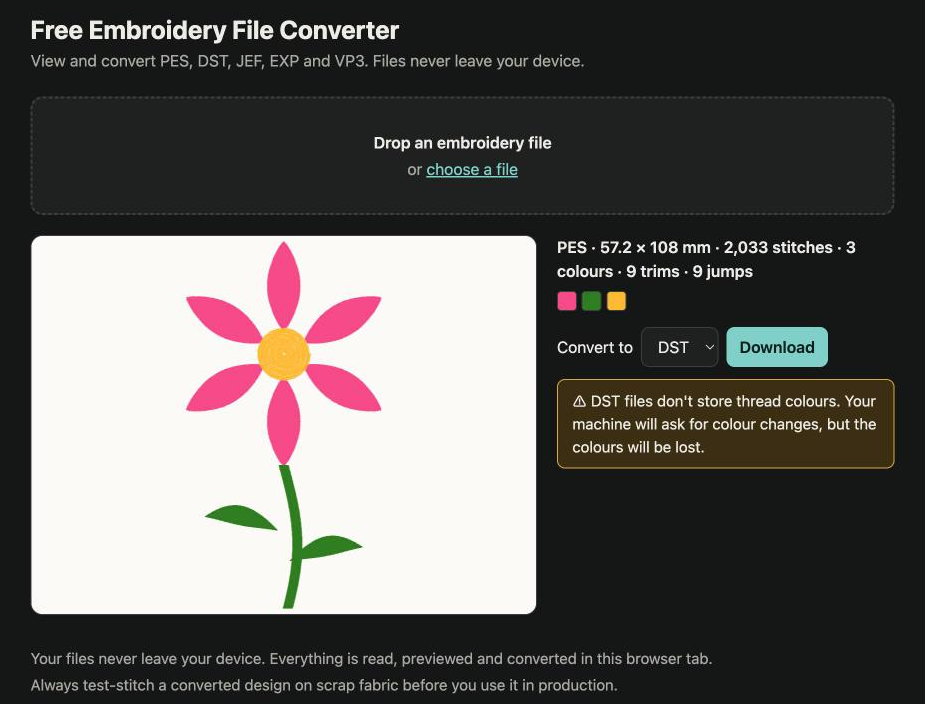

# Embroidery File Converter

A browser-only viewer and converter for **PES, DST, JEF, EXP and VP3** machine embroidery files. It is a TypeScript port of [pystitch](https://github.com/inkstitch/pystitch) 1.0.1, with a small Vite web app and a Docker image.

- Hosted tool: https://mavenwright.com/en/stitchkit/tools/embroidery-file-converter
- Source code (MIT): https://github.com/mavenwright/embroidery-converter
- Docker image: `mavenwright/embroidery-converter:1.0.0`

Made by MavenWright, the team behind StitchKit, a commercial embroidery app. The converter is free, MIT licensed and does not need StitchKit.



## What it does

- Opens a PES, DST, JEF, EXP or VP3 file and shows a preview with the stitch count, colour count and size.
- Converts it to any of the other formats and downloads the result.
- Tells you what the target format cannot keep (see the table below) before you download.

Units are 0.1 mm, as in pystitch.

## Privacy

Files never leave your device. Reading, previewing and converting all run in the browser. There is no upload and no server-side processing: the Docker image only serves static files with nginx. The self-hosted app contains no analytics and makes no network requests of its own, apart from loading its own page and a small `config.json` from the same server (the credit setting, see below).

## Formats

All five formats can be read and written.

| Format | Typical machines | What it stores | What a conversion to it loses |
| --- | --- | --- | --- |
| PES | Brother, Babylock | Stitches, colour changes, stops, thread colours from a fixed palette, a hoop size | Colours are matched to the nearest palette colour. A warning appears when a design is bigger than Brother's standard 130 x 180 mm hoop, or has more colours than the palette (colours then repeat). More than 256 colours cannot be written. |
| DST | Tajima and many commercial machines | Stitches, jumps, trims and colour changes (as machine stops) | No thread colours. The machine asks for colour changes, but the colours are lost. |
| JEF | Janome | Stitches, colour changes, stops, thread colours from a fixed palette, a hoop code | Colours are matched to the nearest palette colour. JEF can only name hoops up to 200 x 200 mm; larger designs are marked for the default 110 x 110 mm hoop and a warning appears. |
| EXP | Melco and Bernina | Stitches, jumps, trims and colour changes | No thread colours. The machine asks for colour changes, but the colours are lost. |
| VP3 | Husqvarna Viking, Pfaff | Stitches, colour blocks with thread colours | Stops cannot be stored, so the pause for placing applique fabric is lost. A warning appears. |

Designs that store no colours (DST, EXP) get stand-in colours when they are converted to a format that needs them. The warning texts live in `src/warnings.ts`.

## Limits

- 1,000,000 stitches per design and 30 MB per input file. Larger files are rejected with a message.
- Read errors: empty file, unrecognised format, damaged or incomplete file, too large.
- Write errors: empty design, more than 256 colours for PES, unsupported option, too large, other write failure.

## How correctness is tested

The converter is tested against pystitch 1.0.1: the writers produce the same bytes and the readers return the same stitches as pystitch for the same input, on a synthetic test corpus, with documented exceptions (stand-in colours for designs that store none). This covers pystitch's behaviour only. It is not a claim about real-world files in other software, so test-stitch a converted file on scrap fabric before production work.

The parity harness is in `tools/parity/` and needs Python 3.12 (see Tests below). The default test suite runs without Python: the tests that call pystitch live are skipped when `tools/parity/.venv` is missing, and the tests against the committed reference files in `corpus/synthetic/` always run.

## Use the library

The conversion code in `src/` has no browser or Node dependencies, so you can use it in your own TypeScript project. It is not published to npm: copy (vendor) the `src/` folder into your project and import from its `index.ts`, for example `import { readEmbroidery, writeEmbroidery } from "./embroidery-converter"`. Keep `LICENSE` and `NOTICE` with the copy.

```ts
import { computeStats, convert, readEmbroidery, renderPattern, writeEmbroidery } from "./embroidery-converter";

const bytes = new Uint8Array(await file.arrayBuffer());
const pattern = readEmbroidery(bytes, file.name); // throws EmbroideryReadError (empty, unknown_format, corrupt, too_large)
const stats = computeStats(pattern); // { widthMm, heightMm, stitches, colors, jumps, trims, colorList }

const pes = writeEmbroidery(pattern, "pes"); // Uint8Array; throws EmbroideryWriteError
const { bytes: dst, warnings, outName } = convert(bytes, file.name, "dst"); // read + write + what the target format loses

renderPattern(pattern, canvas.getContext("2d")!, { width: 480, height: 360 }); // draws the stitches on a canvas
```

`Format` is `"pes" | "dst" | "jef" | "exp" | "vp3"`. `detectFormat(bytes, filename)` and `conversionWarnings(pattern, format)` are exported too, and the per-format `readPes` / `writePes` and friends give direct access to each format.

## Run with Docker

```bash
docker run -d --name embroidery-converter -p 8080:8080 mavenwright/embroidery-converter:1.0.0
```

Then open http://localhost:8080.

With Docker Compose (`docker-compose.yml` in this repository builds the image from source):

```bash
docker compose up -d
```

The image listens on port 8080 and runs as the unprivileged `nginx` user. It sends a Content-Security-Policy of `default-src 'self'` (plus `img-src 'self' blob: data:`), has a healthcheck, and is built for linux/amd64 and linux/arm64.

### SHOW_CREDIT

`SHOW_CREDIT` controls an optional footer line, "Made by the StitchKit team", with an "Edit in StitchKit" link to the hosted tool page.

| Value (case-insensitive) | Result |
| --- | --- |
| unset | footer shown (default) |
| `true`, or any value other than the three below | footer shown |
| `false`, `0`, `no` | footer hidden |

An unrecognised value shows the footer. If the container cannot write its config file (for example a read-only root filesystem), it keeps the shipped default and still starts. To hide the footer there, mount a writable `config.json` containing `{"showCredit":false}` at `/usr/share/nginx/html/config.json`.

```bash
docker run -d -p 8080:8080 -e SHOW_CREDIT=false mavenwright/embroidery-converter:1.0.0
```

## Build from source

Node.js 22 or later.

```bash
npm install
npm run dev        # Vite dev server
npm run build      # static site in dist/
npm run preview    # serve dist/
npm run typecheck  # tsc --noEmit
```

## Tests

```bash
npm test           # vitest run
npm run validate:deploy   # checks the templates in deploy/
```

`npm test` runs the unit tests and the parity tests against the committed synthetic corpus in `corpus/synthetic/`. An optional `corpus/local/` folder (not committed) can hold your own files: with the pystitch virtualenv set up (below), `npm test` also compares how the port reads each of them with pystitch. Write comparisons over the same files come from `npx tsx tools/parity/compare3.ts`, which also writes every file in all five formats with both implementations and compares the bytes.

To regenerate the corpus or run the live parity checks against pystitch:

```bash
python3.12 -m venv tools/parity/.venv
tools/parity/.venv/bin/pip install -r tools/parity/requirements.txt
```

See `tools/parity/README.md` for the scripts.

## Self-hosting catalogs

Templates for self-hosting platforms (Dokploy, Easypanel, Umbrel, Unraid, Zeabur) are in `deploy/`, with the Docker Hub description in `deploy/docker-hub-README.md`. They all run the same image on port 8080.

## Licence

MIT. Copyright (c) 2026 MavenWright. See `LICENSE`.

## NOTICE

The same text is in the `NOTICE` file, which is also copied into the Docker image (`/usr/share/doc/embroidery-converter/`).

### pystitch

This project contains code ported from pystitch (https://github.com/inkstitch/pystitch), which is distributed under the MIT License:

```
MIT License

Copyright (c) 2018

Permission is hereby granted, free of charge, to any person obtaining a copy
of this software and associated documentation files (the "Software"), to deal
in the Software without restriction, including without limitation the rights
to use, copy, modify, merge, publish, distribute, sublicense, and/or sell
copies of the Software, and to permit persons to whom the Software is
furnished to do so, subject to the following conditions:

The above copyright notice and this permission notice shall be included in all
copies or substantial portions of the Software.

THE SOFTWARE IS PROVIDED "AS IS", WITHOUT WARRANTY OF ANY KIND, EXPRESS OR
IMPLIED, INCLUDING BUT NOT LIMITED TO THE WARRANTIES OF MERCHANTABILITY,
FITNESS FOR A PARTICULAR PURPOSE AND NONINFRINGEMENT. IN NO EVENT SHALL THE
AUTHORS OR COPYRIGHT HOLDERS BE LIABLE FOR ANY CLAIM, DAMAGES OR OTHER
LIABILITY, WHETHER IN AN ACTION OF CONTRACT, TORT OR OTHERWISE, ARISING FROM,
OUT OF OR IN CONNECTION WITH THE SOFTWARE OR THE USE OR OTHER DEALINGS IN THE
SOFTWARE.
```

### CPython

`src/core/pyset.ts` reimplements the iteration order of sets in CPython 3.12 (`Objects/setobject.c`, https://github.com/python/cpython), which is distributed under the Python Software Foundation License Version 2. Python is a trademark of the Python Software Foundation. The licence requires its agreement and copyright notice to be retained in derivative versions:

Copyright (c) 2001, 2002, 2003, 2004, 2005, 2006, 2007, 2008, 2009, 2010, 2011, 2012, 2013, 2014, 2015, 2016, 2017, 2018, 2019, 2020, 2021, 2022, 2023 Python Software Foundation; All Rights Reserved

```
PYTHON SOFTWARE FOUNDATION LICENSE VERSION 2
--------------------------------------------

1. This LICENSE AGREEMENT is between the Python Software Foundation
("PSF"), and the Individual or Organization ("Licensee") accessing and
otherwise using this software ("Python") in source or binary form and
its associated documentation.

2. Subject to the terms and conditions of this License Agreement, PSF hereby
grants Licensee a nonexclusive, royalty-free, world-wide license to reproduce,
analyze, test, perform and/or display publicly, prepare derivative works,
distribute, and otherwise use Python alone or in any derivative version,
provided, however, that PSF's License Agreement and PSF's notice of copyright,
i.e., "Copyright (c) 2001, 2002, 2003, 2004, 2005, 2006, 2007, 2008, 2009, 2010,
2011, 2012, 2013, 2014, 2015, 2016, 2017, 2018, 2019, 2020, 2021, 2022, 2023 Python Software Foundation;
All Rights Reserved" are retained in Python alone or in any derivative version
prepared by Licensee.

3. In the event Licensee prepares a derivative work that is based on
or incorporates Python or any part thereof, and wants to make
the derivative work available to others as provided herein, then
Licensee hereby agrees to include in any such work a brief summary of
the changes made to Python.

4. PSF is making Python available to Licensee on an "AS IS"
basis.  PSF MAKES NO REPRESENTATIONS OR WARRANTIES, EXPRESS OR
IMPLIED.  BY WAY OF EXAMPLE, BUT NOT LIMITATION, PSF MAKES NO AND
DISCLAIMS ANY REPRESENTATION OR WARRANTY OF MERCHANTABILITY OR FITNESS
FOR ANY PARTICULAR PURPOSE OR THAT THE USE OF PYTHON WILL NOT
INFRINGE ANY THIRD PARTY RIGHTS.

5. PSF SHALL NOT BE LIABLE TO LICENSEE OR ANY OTHER USERS OF PYTHON
FOR ANY INCIDENTAL, SPECIAL, OR CONSEQUENTIAL DAMAGES OR LOSS AS
A RESULT OF MODIFYING, DISTRIBUTING, OR OTHERWISE USING PYTHON,
OR ANY DERIVATIVE THEREOF, EVEN IF ADVISED OF THE POSSIBILITY THEREOF.

6. This License Agreement will automatically terminate upon a material
breach of its terms and conditions.

7. Nothing in this License Agreement shall be deemed to create any
relationship of agency, partnership, or joint venture between PSF and
Licensee.  This License Agreement does not grant permission to use PSF
trademarks or trade name in a trademark sense to endorse or promote
products or services of Licensee, or any third party.

8. By copying, installing or otherwise using Python, Licensee
agrees to be bound by the terms and conditions of this License
Agreement.
```

Summary of the changes (PSF License Agreement, section 3): src/core/pyset.ts is a TypeScript reimplementation of how CPython 3.12 orders the items of a `set` when it is iterated (the hash-table insertion, probing and resize steps of Objects/setobject.c). It is not a copy of CPython source and it only models the cases this converter needs; the behaviour is checked against a real CPython 3.12 interpreter in test/core/pyset.test.ts.
